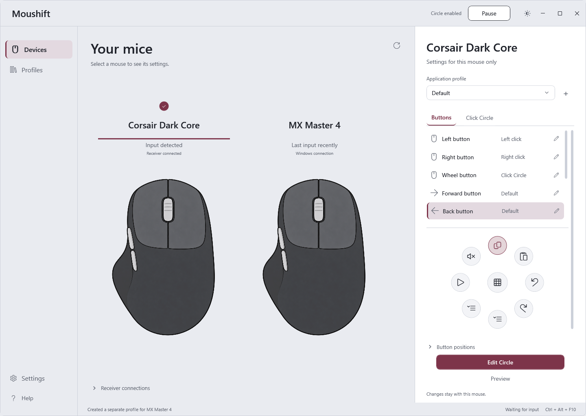

# Moushift

A Windows mouse configuration workspace with per-connection profiles, an editable Click Circle, and generic HID button discovery and learning. Built with .NET 10 / WPF, without third-party NuGet packages.

**Preview software.** HID discovery and learning are separate from exclusive input remapping. A learned input is not automatically an intercepted or remappable input. This preview does not claim support for every physical button on every mouse.

## What works

- Side-by-side mouse gallery with a persistent inspector for the selected mouse and independent device/application profiles.
- Click Circle: searchable action library, drag/drop, folders, shortcut parameters and undo/redo.
- Generic HID descriptor discovery without a manufacturer/model allowlist or vendor commands.
- Teach a button: choose a point on the mouse drawing, explicitly listen, press the same input twice, name it and save locally.
- Learned input identities and normalized drawing positions persist per connection. Learning/repositioning does not change the device firmware or vendor configuration.
- Light (silver / wine) and dark (charcoal / muted rose) themes, switchable from the title bar or Settings.
- Atomic local settings writes with a last-good backup.



## Current boundaries

| Capability | Status |
| --- | --- |
| Descriptor discovery | Reads accessible Windows HID capabilities; declared usages are not a count of physical buttons |
| Button learning | Standard mouse buttons/wheel, declared HID button usages, and F13–F24 from associated interfaces |
| Firmware-only buttons | Cannot be learned when no accessible event is emitted |
| Physical button location | Chosen manually on the drawing; HID does not supply universal diagram coordinates |
| Driverless Click Circle | Five standard buttons, exact source mouse and foreground app profile; original trigger still reaches Windows |
| Standard live remapping | Optional Interception backend for exclusive remapping; separate installation and verified source routing |
| Arbitrary learned HID remapping | Not implemented; assignments are explicitly stored as inactive drafts |
| Receiver identity | A receiver may represent multiple devices; its presence does not prove mouse power or uniquely identify a paired mouse |
| Manufacturer-specific protocols | Not used for generic discovery/learning; no vendor output/feature reports are sent |

The app starts paused. With connected Raw Input sources it offers **Enable Circle**, requiring no driver. This mode activates only standard-button Circle bindings; other assignments remain inactive and the original trigger reaches Windows. Custom HID and wheel triggers are not live in this mode. No driver is bundled or automatically installed.

## Run

Requires Windows and the .NET 10 Desktop Runtime (x64 for the portable build). Extract a release ZIP and run `Moushift.exe`. For a local source build, use `Start-Moushift.cmd` after building.

1. Select your mouse connection in **Devices**.
2. Open **Button positions → Teach a button…** in that mouse's inspector.
3. Click its position on the drawing.
4. Click **Listen for button**, release held buttons, and press the target twice.
5. Review the detected identity/name and choose **Save button**.

If no event arrives, the button may be handled internally or its collection may be inaccessible. Choosing a diagram point alone does not manufacture a detectable input. Original hardware functions can still occur during learning.

## Build and verify

Install the .NET 10 SDK, then in PowerShell:

```powershell
./scripts/Build.ps1
./scripts/Verify.ps1
./scripts/Package.ps1
```

The test suites run without starting hooks or injecting input. WPF checks render offscreen using isolated data. The optional read-only hardware inspection command is:

```powershell
dotnet run --project tests/Clickloom.Windows.Tests -c Release -- --hid-discovery
```

Real device presses, OLE drag/drop smoothness, wireless receivers and live remapping need separate hardware acceptance. A green fixture test is not hardware certification.

## Data and privacy

Moushift was previously named Clickloom. To preserve existing assignments, profiles and themes without copying or resetting them, settings remain in `%LOCALAPPDATA%/Clickloom/profiles.json`; appearance is separate. Development/tests use `CLICKLOOM_DATA_DIR`. The learning listener is temporary and restricted to interfaces associated with the selected connection. Ordinary keyboard typing is ignored; the dedicated keyboard fallback only accepts F13–F24. There is no telemetry or automatic upload of reports/profiles.

Do not attach personal profiles, device serials, raw device paths or unreviewed input captures to public issues. See [contributing](CONTRIBUTING.md), [learning design](docs/HID_LEARNING.md) and [known limits](docs/KNOWN_LIMITS.md).

## Project workflow

Issue forms cover bugs and undetected inputs. Pull requests run Windows build/tests/offscreen previews. Tagged releases run verification and produce a **draft prerelease**, including a portable ZIP and SHA-256 checksum; publishing is a separate maintainer action. CI and remote releases are not claimed to have run before the repository is published.

See [release notes](docs/releases/v0.14.1-preview.md). License: [MIT](LICENSE).
