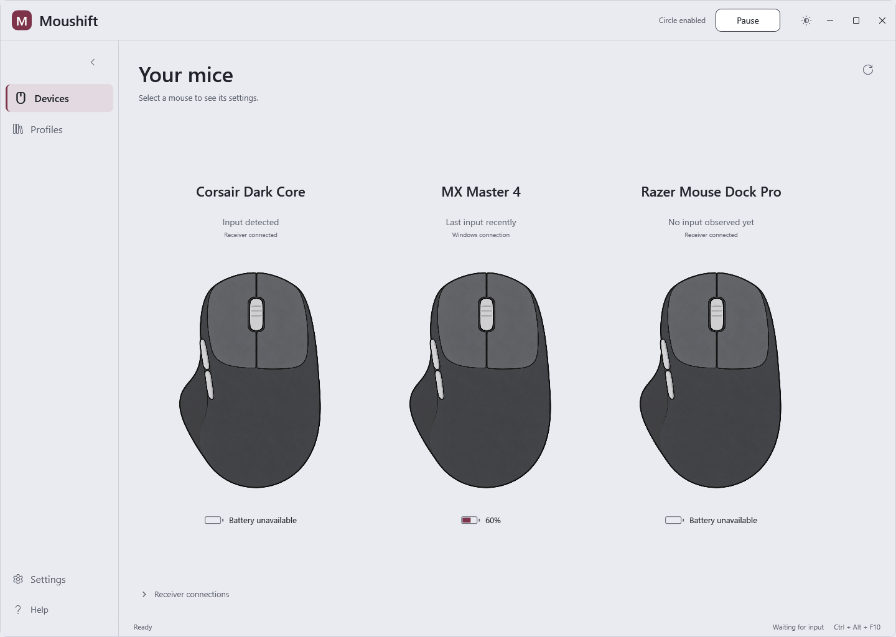

# Moushift


A Windows mouse configuration workspace with per-connection profiles, an editable Click Circle, and generic HID connection discovery. Built with .NET 10 / WPF, without third-party NuGet packages.

**Preview software.** Connection discovery is separate from exclusive input remapping. Previously learned inputs are preserved for compatibility, but new button learning has been removed. This preview does not claim support for every physical button on every mouse.

## What works

- Side-by-side mouse gallery. Select any card to open that mouse alone in the center with its resizable settings inspector on the right. Navigation collapses to icons; profiles stay independent per mouse/application.
- Battery badges on the gallery and selected mouse, when Windows exposes a percentage. Missing readings stay explicitly unavailable; no proprietary receiver protocol is used.
- Click Circle in the main workspace: centered Circle with a searchable, draggable action library on the right, folders, shortcut parameters and undo/redo.
- Generic HID descriptor discovery without a manufacturer/model allowlist or vendor commands.
- Light (silver / green) and dark (charcoal / neon mint) themes, switchable from the title bar or Settings.
- Atomic local settings writes with a last-good backup.



## Current boundaries

| Capability | Status |
| --- | --- |
| Descriptor discovery | Reads accessible Windows HID capabilities; declared usages are not a count of physical buttons |
| Button learning | Removed from the app; existing saved identities, positions and bindings are retained |
| Firmware-only buttons | Cannot be learned when no accessible event is emitted |
| Physical button location | Standard markers and previously saved positions; HID does not supply universal diagram coordinates |
| Driverless Click Circle | Standard buttons and horizontal tilt, exact mouse/app profiles; assigned middle clicks replace native clicks |
| Standard live remapping | Optional Interception backend for exclusive remapping; separate installation and verified source routing |
| Arbitrary learned HID remapping | Not implemented; assignments are explicitly stored as inactive drafts |
| Receiver identity | A receiver may represent multiple devices; its presence does not prove mouse power or uniquely identify a paired mouse |
| Manufacturer-specific protocols | Not used for generic discovery/learning; no vendor output/feature reports are sent |

The app starts paused. With connected Raw Input sources it offers **Enable Circle**, requiring no driver. Standard-button and horizontal-tilt Circle bindings are live; other assignments remain inactive. Assigned middle clicks replace native desktop clicks, while other mice's middle clicks are forwarded as tagged synthetic input. Other trigger buttons retain their original behavior. Custom HID and vertical-wheel triggers are not live in this mode. No driver is bundled or automatically installed. See [driverless limits](docs/DRIVERLESS_CIRCLE.md) for Raw Input applications and elevated-window restrictions.

## Run

Requires Windows 10/11 x64. The release ZIP includes the .NET and Windows Desktop runtimes: extract the complete folder and run `Moushift.exe`, without installing .NET separately. Keep all extracted files together. Source development requires the .NET 10 SDK; use `Start-Moushift.cmd` after a local build.

1. Select your mouse connection in **Devices**.
2. Choose a standard button on the drawing or in the button list.
3. Assign **Click Circle**, apply it, then choose **Enable Circle**.
4. Test outside the editor. Only this mouse uses its saved device/application profile.

Teach a button and its listening workspace have been removed. Existing saved custom inputs and assignments are retained without a settings reset; arbitrary HID assignment drafts remain inactive.

## Build and verify

Install the .NET 10 SDK, then in PowerShell:

```powershell
./scripts/Build.ps1
./scripts/Verify.ps1
./scripts/Package.ps1
```

`Package.ps1` builds and verifies a self-contained Windows x64 ZIP. It runs the packaged executable offscreen with empty shared-runtime search roots and checks that app-local CoreCLR is used in both themes. `Build.ps1` keeps the regular development build; `Build.ps1 -SelfContained` produces the standalone publish output.

The test suites run without starting hooks or injecting input. WPF checks render offscreen using isolated data. The optional read-only hardware inspection command is:

```powershell
dotnet run --project tests/Clickloom.Windows.Tests -c Release -- --hid-discovery
```

Real device presses, OLE drag/drop smoothness, wireless receivers and live remapping need separate hardware acceptance. A green fixture test is not hardware certification.

## Data and privacy

Moushift was previously named Clickloom. To preserve existing assignments, profiles and themes without copying or resetting them, settings remain in `%LOCALAPPDATA%/Clickloom/profiles.json`; appearance is separate. Navigation collapse and inspector width are stored separately in `workspace.json`. Development/tests use `CLICKLOOM_DATA_DIR`. The app no longer starts a button-learning listener. There is no telemetry or automatic upload of reports/profiles.

Do not attach personal profiles, device serials, raw device paths or unreviewed input captures to public issues. See [contributing](CONTRIBUTING.md), [historical learning design](docs/HID_LEARNING.md) and [known limits](docs/KNOWN_LIMITS.md).

## Project workflow

Issue forms cover bugs and undetected inputs. Pull requests run Windows build/tests/offscreen previews. Release tags and `release/v<version>-preview.<number>` branches run verification and produce a **draft prerelease**, including a portable ZIP and SHA-256 checksum; publishing is a separate maintainer action. The workflow also supports a manual preview-tag input. Published releases are never overwritten by the draft helper.

See [release notes](docs/releases/v0.14.4-preview.md). License: [MIT](LICENSE).
